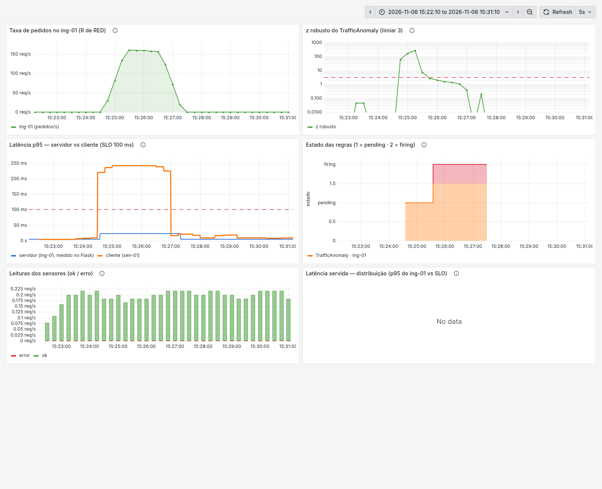

# Grafana como código

> **Para quê:** os dashboards do SOC (R5/R6/R7) e a figura obrigatória do relatório *"Grafana durante uma
> PoC"*. Tudo nasce do Git: as datasources do **inventário**, os dashboards de um **gerador em Python**.

| Ficheiro | O que é |
|---|---|
| [`build_dashboards.py`](build_dashboards.py) | **fonte** dos dashboards (escreve `dashboards/*.json`) |
| `dashboards/ssle-soc.json` | SOC: Geomap dos sites (`site:info:last` + `site:up:ratio`), disponibilidade, incidentes do correlator (abertos, à espera do *settle*, redução de ruído), alertas a disparar em **todos** os sites (`site:alerts:firing`), custo da federation (R5), elementos dinâmicos (R2) |
| `dashboards/ssle-t1.json` | T1 no `ing-01`: taxa (R), z robusto, **latência servidor vs cliente** com o SLO, estado das regras, leituras dos sensores |
| [`providers/ssle.yml`](providers/ssle.yml) | *provider*: sem ele o Grafana ignora os JSON (faltava antes de 08/11) |
| `infra/inventory.py grafana` | datasources geradas do inventário: `prom-global`, `prom-<site>` (drill-down por instância, que o global não tem), `alertmanager` |
| [`it-local.sh`](it-local.sh) | valida o provisioning com um **Grafana 11.6.1 real** em 127.0.0.1 |
| [`replay-t1.sh`](replay-t1.sh) | reproduz a evidência da T1 no dashboard e tira as figuras para `report/figures/` |

No lab, o `infra/deploy.sh` (perfil `full`) instala o Grafana 11.6.1 no `core/obs` a partir do repositório apt
oficial (chave assinada, versão fixada), escuta **só** no IP do `obs` na `net-core` (chega-se por túnel SSH),
sem acesso anónimo, com a password de admin **gerada** em `build/secrets/grafana-admin.pass` (fora do Git).

🧠 **Porquê datasources por site:** o Prometheus global só recebe agregados (`site.*:.*`, `up` e os alertas
ativos) — é isso que poupa banda (R5). O detalhe por instância (a taxa do `ing-01`, o p95 de cada sensor) fica
no `prom-01` de cada site, e o Grafana vai lá buscá-lo só quando alguém abre o drill-down.

## Validação (08/11/2026, output real)

```text
(t490$) bash monitoring/grafana/it-local.sh
[grafana] versão 11.6.1 · db ok
  datasources: alertmanager, prom-avr, prom-global, prom-lis, prom-opo
  dashboards: SSLE/ssle-soc, SSLE/ssle-t1
  ssle-soc: 11 painéis (geomap, stat, table, timeseries)
  ssle-t1: 6 painéis (timeseries)
RESULTADO: provisioning do Grafana sem erros ✅
```

Na CI (`bash tools/test-all.sh`): as **21 expressões PromQL** dos dashboards passam pelo `promtool` (embrulhadas
em recording rules) e verifica-se que os JSON são exatamente o que o gerador produz (ninguém os editou à mão).

## Figura da T1 — *replay* da evidência de staging (06/11, execução 1)

`bash monitoring/grafana/replay-t1.sh 1` → `report/figures/t1-replay-run1-{dashboard,latencia,regras}.png`



Como é feito: os JSON guardados em `threats/t1-ddos/evidence/run-*/` (respostas do Prometheus a 5 s) são
convertidos em OpenMetrics, importados num TSDB local com `promtool tsdb create-blocks-from openmetrics`,
servidos por um Prometheus 2.53.5 em 127.0.0.1 e vistos com **o mesmo dashboard** do lab.

⚠️ **É um replay, não uma medição nova** — e a legenda no relatório tem de o dizer:
- o p95 do sensor e as leituras eram resultados de expressões; aqui recebem as labels do `sen-01` (o único
  sensor do staging) para caberem nas consultas do dashboard;
- o z robusto é recalculado sobre a janela guardada (há < 1 h de linha de base);
- o `ClientLatencySLO` ainda não existia a 06/11, por isso não aparece no estado das regras;
- o painel "Latência servida — distribuição" fica vazio (os *buckets* em bruto não foram guardados);
- o Prometheus do replay usa `--query.lookback-delta=15s` (o backfill não traz *staleness markers*): o fim do
  *firing* aparece até 15 s mais tarde do que foi.

A figura definitiva (com o `ClientLatencySLO` e a resposta automática) sai das execuções no T490.

## Erros encontrados pelo caminho (e porque contam para o relatório)

- **State-timeline mente quando a série acaba:** prolonga o último estado até ao fim do gráfico, por isso um
  alerta resolvido às 15:27 aparecia *firing* até às 15:31. Trocado por uma série em degraus.
- **Duas séries com a mesma cor** no painel da latência — exatamente o painel que conta a lição da T1. Cores
  fixas por *query* (servidor azul, cliente laranja).

## O que levar contigo

- **Dashboards são código:** gerador + JSON versionados + provider + datasources do inventário = o Grafana
  reconstrói-se sem cliques.
- **O global vê agregados; o drill-down vai ao site.** É a mesma escolha de arquitetura do R5, no Grafana.
- **Uma figura de um replay vale como ilustração, não como medição** — e diz-se isso na legenda.
